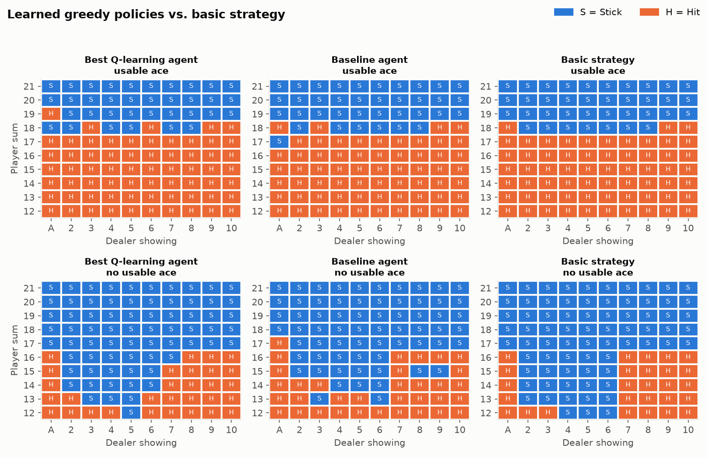

# CPSC 4420 – Assignment 2: Q-learning on Blackjack

Tabular Q-learning agent for Gymnasium's `Blackjack-v1`, with experiments on the
learning rate α, discount factor γ, exploration schedule, and an added
action-noise source of stochasticity.



## Files

| File | What it is |
|---|---|
| `qlearning.py` | The Q-learning agent, ε schedule, training loop, evaluation, action-noise wrapper, reference policies |
| `experiments.py` | Runs every experiment (report parts C–H) and writes plots and tables to `results/` |
| `make_video.py` | Records the best agent playing to `videos/blackjack_agent.mp4` |
| `results/` | All plots, `tables.md` (every number in the report), `summary.json`, `best_agent.json` (the learned Q-table) |
| `videos/blackjack_agent.mp4` | The trained agent playing 12 hands |
| `report/HW2_Report.pdf` | The written report |

## Setup

Python 3.10+.

```bash
git clone https://github.com/edang2349/BlackJackQLearning.git
cd BlackJackQLearning
python -m venv .venv
# Windows: .venv\Scripts\activate    macOS/Linux: source .venv/bin/activate
pip install -r requirements.txt
```

`make_video.py` needs ffmpeg. It uses `ffmpeg` from your PATH, or the copy that
the `imageio-ffmpeg` package installs.

## Running

```bash
python experiments.py              # all experiments, 10 seeds each (~12 min on 16 cores)
python experiments.py --seeds 3    # quicker run
python make_video.py               # video of the best agent (needs results/best_agent.json)
```

`experiments.py` spreads training runs over all CPU cores. Use `--workers N` to
change that. Every run is seeded, so the same command reproduces the same numbers.

### Training a single agent

Every hyperparameter is a field of `Config` in `qlearning.py`:

```python
from qlearning import Config, train, evaluate

cfg = Config(alpha=0.01, gamma=1.0, eps_start=1.0, eps_end=0.05,
             eps_decay_frac=0.5, n_episodes=200_000, q_init=0.0, noise_p=0.0)
agent, history = train(cfg, seed=0)
print(evaluate(lambda obs: agent.act(obs, explore=False), n_episodes=10_000))
```

## Results summary

The best configuration was α = 0.01, γ = 1, with ε decaying linearly from 1.0 to 0.05
over the first 90% of 200k training episodes. It was chosen by mean greedy reward over
10 seeds on 50k validation hands. Results on 100k separate test hands, with exploration off:

| Policy | Mean reward ± 95% CI | Win | Draw | Loss |
|---|---|---|---|---|
| Best Q-learning agent | −0.054 ± 0.006 | 42.5% | 9.5% | 48.0% |
| Baseline Q-learning agent | −0.057 ± 0.006 | 42.4% | 9.5% | 48.1% |
| Basic strategy (reference) | −0.047 ± 0.006 | 43.0% | 9.3% | 47.7% |
| Random policy | −0.398 ± 0.006 | 27.9% | 4.3% | 67.7% |

Blackjack has a house edge, so even perfect play loses money on average. The target is
basic strategy's −0.047 per hand, not a positive reward. All results are in
[`results/tables.md`](results/tables.md).

| Figure | Report part |
|---|---|
| [`C_baseline_training.png`](results/C_baseline_training.png) | C – baseline reward vs. episode |
| [`D_alpha.png`](results/D_alpha.png) | D – learning rate |
| [`E_gamma.png`](results/E_gamma.png), [`E_gamma_policies.png`](results/E_gamma_policies.png) | E – discount factor |
| [`F_epsilon.png`](results/F_epsilon.png) | F – exploration schedule |
| [`G_policies.png`](results/G_policies.png) | G – best agent's policy vs. basic strategy |
| [`H_noise.png`](results/H_noise.png), [`H_noise_policies.png`](results/H_noise_policies.png) | H – action noise |
